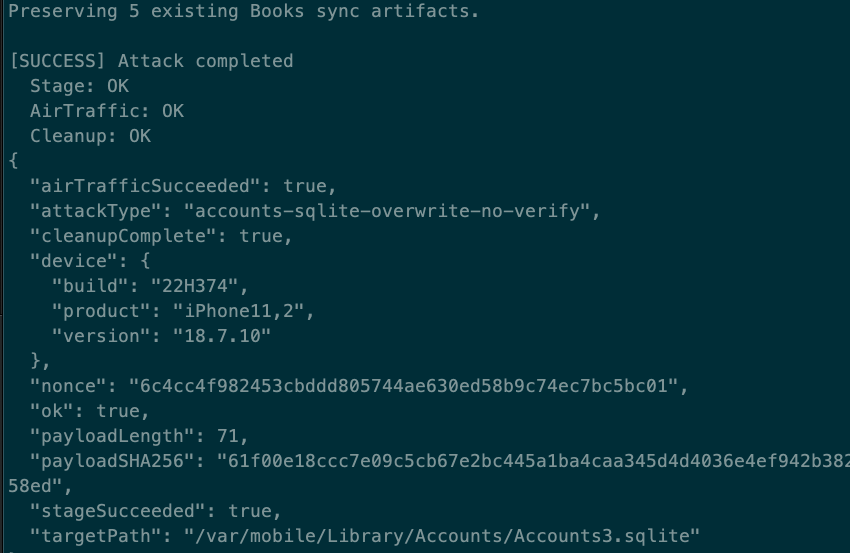

# Hide Apple Account

Theoretically supports iOS 27 (24A437A). Untested.

If the account is still active after running the script, please try to restore all settings of the mobile phone.

## Result



## Attack chain

```text
Generate 24 random bytes
        |
        v
Encode them as a 48-character hexadecimal nonce
        |
        v
Construct a 71-byte UTF-8 payload
        |
        v
Write directly using AFC mode 3
        |
        v
AFCFileRefOpen(path, mode=3, &file)
        |
        v
AFCFileRefWrite(file, payload, 71)
        |
        v
AFCFileRefClose(file)
        |
        v
/var/mobile/Library/Accounts/Accounts3.sqlite is overwritten
```

## Acknowledgments

Thanks to the [Airlift project](https://github.com/0xjohnnydev/airlift).
